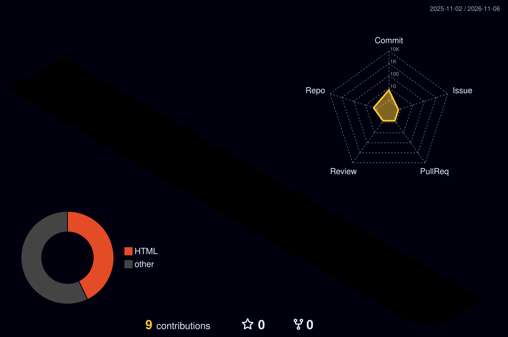

  

  

  
  

---

## 👨‍💻 About Me

💼 Analyst @ eClerx, Coimbatore  
🎓 BE Mechatronics, SKCET (2024)  
🎯 Moving into Data Analyst / Data Engineer roles  
📈 Building SQL, Python and Power BI projects

---

## 🧰 Tech Stack

  
  
  
  
  
   
  
  
  
  
  
   
  
  
  

---

## 🌐 My 3D Contribution Graph

  

---

## 🔥 GitHub Streak

  

---

## 🚀 Projects

| Project | Tools | Status |
|---|---|---|
| 🚲 Bike Buyers Data Analysis | Excel | ✅ Done |
| 🗄️ SQL Project (basic → medium) | SQL | 🔨 Coming soon |
| 🐍 Python Data Project | Python, Pandas, NumPy | 🔨 Coming soon |
| 📈 Sales Dashboard | Advanced Excel, Power BI | 🔨 Coming soon |

---

## 🎓 Certifications

- 📘 Google Data Analytics Professional Certificate
- 📘 IBM Data Science Professional Certificate
- 📘 Meta Marketing Analytics Professional Certificate
- 📘 Excel Skills for Business Specialization (Macquarie University)

---

## 📫 Let's Connect

  

  

